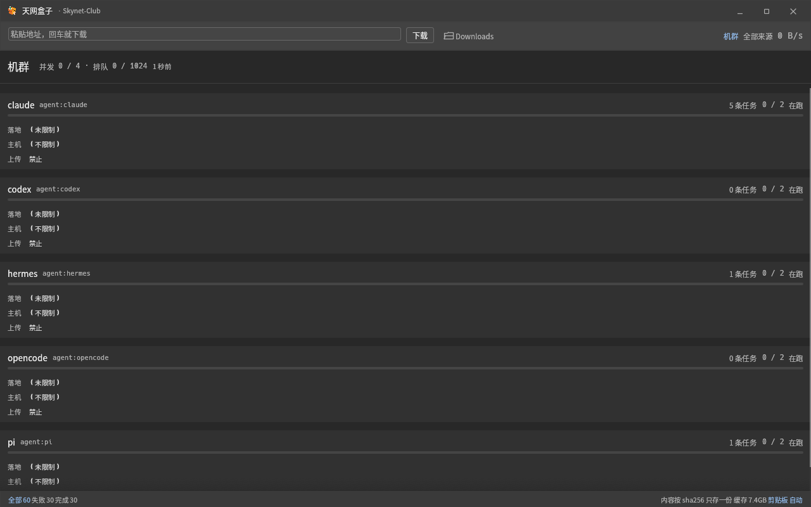

<div align="center">


# 天网盒子 · Skynet Data Box

**一台机器上所有 agent 共用的本机数据盒子。**

可信下载与上传 · 断点续传 · 内容寻址缓存 · 公平调度 · per-agent 限权

**当前正式支持：Ubuntu Linux x86_64** · macOS / Windows 在路线图中

[v0.24.15 Preview](https://github.com/Skynet-Club/skyget/releases/tag/v0.24.15-preview)
· [MCP](https://github.com/Skynet-Club/skyget/blob/main/docs/deploy.md)
· [Security](SECURITY.md)
· [MIT](LICENSE)

</div>



> English quick start: [README.en.md](README.en.md)

## 为什么需要它

下载速度在 2026 年不是问题；问题是**取完之后**：拿到的对不对、存了几份、谁装的、
装到哪、下次还要不要重下；以及多个 agent 同时取数据时，谁先跑、能写到哪、
失败了怎么接着来。

这一整段，现有下载器、下载站和网盘全部留白 —— 而 agent 恰好卡在这里。

```bash
sha256sum -c skynet-dataplane_0.24.15_amd64.deb.sha256
sudo apt install ./skynet-dataplane_0.24.15_amd64.deb
skyget daemon ensure
skyget doctor

skyget get https://example.com/model.safetensors \
  -o ~/models --sha256 <64-char-sha256> --as codex --detach
skyget watch <job-id>
```

`skyget` 同时提供 CLI、MCP、HTTP API 和 GUI。它们共享同一本台账、同一份缓存、
同一个调度器和同一套权限边界。

> 产品名是 **天网盒子 / Skynet Data Box**。为兼容已有安装，发行包、环境变量和
> 二进制仍保留 `skynet-dataplane` / `skynet-dataplaned` 名称，它们不是当前的对外品牌。
> 项目署名与品牌归属按 **Skynet-Club** 统筹，最终署名以双方共同确认为准。
> 详情见 [AUTHORS.md](AUTHORS.md)。

<details>
<summary><strong>English summary</strong></summary>

Skynet Data Box is a local daemon for machines where multiple AI agents download,
upload, and reuse large data. It provides SHA-256-gated transfers, resumable partials,
a content-addressed cache, fair scheduling, an auditable ledger, and per-agent policy.

It exposes one shared core through a CLI, MCP, HTTP API, and desktop GUI.

</details>

> 旧名「天网下载器 / `skynet-download` / `skynet-downloadd`」继续可用；新主名是
> `skynet-dataplane`（GUI）与 `skynet-dataplaned`（守护进程）。
> `skyget` 命令、`app_id`、数据目录保持兼容，已安装的入口不用重装。

## 文档

- [命令行参考](docs/cli.md)：所有命令、参数、默认值、环境变量、MCP 工具
- [部署与策略](docs/deploy.md)：systemd、per-agent token、策略、配额、凭证
- [平台支持与路线图](docs/platform-support.md)：Ubuntu 正式支持、macOS/Windows 规划
- [安全模型](docs/security.md)：信任边界、SSRF/凭证/路径控制、部署清单与残余风险
- [发布与验收](docs/release.md)：构建、28 个 e2e、打包、部署、回滚清单
- [架构决策](docs/adr/)：单写者、安全边界、上传、detach、进度面、凭证与配额
- [Agent 工作规则](CLAUDE.md)：大文件何时必须走 skyget、何时不要用
- [skyget-transfer skill](.claude/skills/skyget-transfer/SKILL.md)：agent 的调用工作流
- [产品手册](MANUAL.md)：界面逐块说明、下载/校验/失败/排障
- [HTTP 契约](docs/api-v1.md)：TaskView、事件、错误码、策略、限制
- [一致性证据](docs/conformance.md)：每条契约对应哪个测试
- [变更记录](CHANGELOG.md)：行为变化和兼容性
- [产品介绍](docs/product-intro.md)：对外的一页版（是什么、给谁、解决什么、不做什么、怎么装、证据）
- [设计哲学](docs/philosophy.md)：为什么这样做，以及「因此我们拒绝了什么」
- [发行公告 0.24](docs/announcement-0.24.md)：可直接贴到 release 页面的那一版
- [发行说明 0.24](docs/release-notes-0.24.md)：这一版的故事、**已知边界 9 条**、升级步骤、产物 sha256
- [许可证](LICENSE) / [第三方代码](THIRD_PARTY.md) / [安全策略](SECURITY.md)
- [夜班记录 2026-10-31](docs/night-shift-2026-10-31.md)：本轮审计修复与验证证据

## 平台支持

**0.24.15 唯一正式支持的平台是 Ubuntu Linux x86_64。**

- 发布包：`skynet-dataplane_0.24.15_amd64.deb`；
- 验证环境：Ubuntu 26.04.1 LTS x86_64；
- 二进制要求 `glibc >= 2.39`；Ubuntu 22.04 及更早版本不能直接运行；
- Ubuntu 24.04 LTS 满足 ABI 下限，但 0.24.15 没有单独做 24.04 发行验收；
- 原生 Windows 尚未支持；macOS 目前只有源码探索与交叉检查，没有官方包；
- WSL2 中的 Ubuntu 走 Linux 支持路径，不属于原生 Windows 支持。

Windows 10/11 和 macOS 的目标、当前状态及技术工作见
[平台支持与路线图](docs/platform-support.md)。

## 构建

    cargo build --release --features full     # 全量：直链 + 种子 + 界面
    cargo build --release                     # 只编默认的 http 面（含 CLI）
    cargo build --release --features gui      # 只编界面

feature 的意义在下游：天网机库只想装个二进制，不该被拖进 tokio + librqbit 那一整套。

| feature | 带进什么 | 谁用 |
|---|---|---|
| `http`（默认） | 直链、切片流、清单、自检、本地接口 | 机库、agent |
| `bt` | + librqbit / tokio（magnet、.torrent） | 数据盒子 / 桌面端 |
| `gui` | + eframe / egui（界面） | 桌面端 |

Debian 包：`packaging/build-deb.sh` 产出 `dist/skynet-dataplane_<version>_<arch>.deb`
（含 CLI / daemon / MCP / GUI / 用户服务 / 桌面图标）。

## 关窗口不打断下载（托盘）

点右上角 × 或按 Ctrl+W，窗口最小化（收进任务栏），**下载线程照跑**。
**Wayland 上做不到「把窗口藏起来」**：winit 的 wayland 后端里 `set_visible()` 是空实现
（源码注释就是 “Not possible on Wayland”），`set_minimized(false)` 和 `focus_window()` 同样被忽略。
所以这里的「收起来」= 最小化，找回窗口靠 dash / Alt+Tab，而不是托盘菜单 ——
GNOME 下程序既藏不起窗口，也抢不回焦点。托盘菜单因此在 Wayland 下只剩「退出」。
再点一次桌面图标不会开第二个窗口，而是把收起来的那个叫回来（单实例，走 SIGUSR1 唤醒）。

    skynet-dataplane --hidden    # 开机自启用：启动就在托盘里，不弹窗（旧名 skynet-download 同样可用）

没有托盘宿主时（比如 GNOME 的 appindicator 扩展没启用）会退化成「关窗口即退出」，
并在 stderr 说明原因 —— 绝不留一个「关了窗口却找不到入口」的死角。

托盘走 D-Bus 的 StatusNotifierItem，不引 GTK；图标只报主题名 `skynet-download`，
尺寸由桌面从 hicolor 里挑。

## 装进桌面

    cargo build --release --features full
    scripts/install-desktop.sh

没有 sudo 的机器先装二进制（实体文件，不是软链；见 `scripts/install-user.sh`）：

    scripts/install-user.sh          # ~/.local/bin 下六个入口 + ~/.local/share/doc

然后装桌面入口：

脚本会从 `target/release` 安装 GUI 和守护进程到 `~/.local/bin`（已有同名文件则沿用），
再装 systemd 用户服务与桌面入口。装完应用列表里搜「天网盒子」就能启动，
也可以 `gtk-launch skynet-download`（桌面文件 ID 保留旧名，产品显示名是天网盒子）。
旧入口 `skynet-download` 仍然可用，两个名字是同一个程序、同一个窗口实例。
脚本做三件事：按 16→512 八个尺寸生成图标、写 `.desktop` 入口、刷新桌面缓存；重复跑是幂等的。

图标是 `packaging/icon.svg`（源图），构建时另有一份 256×256 PNG 嵌进二进制作为窗口图标 ——
所以哪怕从别处拷一个裸二进制过去，窗口图标也不会丢。

窗口的 `app_id` / `WM_CLASS` 保留为 `skynet-download`：Dock 归并、托盘图标和已安装的
桌面文件都靠它，改名不改变这个内部标识。

## 作为 SDK 用（天网机库就是这种用法）

对外**承诺稳定**的只有 `skyfetch::sdk` 这一个面，五个符号：

    Task       要下什么（Task::new(url, dest).expecting(sha).from_agent("x")）
    Event      过程（Probing / Planned / Progress / ProgressSecs / Links / Named / Verifying / Finished）
    run        干活（run(&store, &engine, &mut task, &cb)）
    Store      台账（谁下的、什么 hash、落到哪里）
    verify     自检（六条不变式）

其余 `pub` 模块是实现细节，会随版本变化 —— 下游请只依赖 `skyfetch::sdk`。

    use skyfetch::sdk::{run, Engine, Event, Store, Task};
    let mut task = Task::new(url, "~/apps");
    run(&Store::open()?, &Engine::new(4), &mut task, &|e: Event| { /* 画进度 */ })?;
    // task.dest / task.sha256 / task.trust 就是结论

`scripts/../examples/embed.rs` 是完整可跑的样例（只用 sdk 面，不 import reqwest）：

    cargo run --example embed --no-default-features --features http -- <url> <目录>

`skyfetch::sdk::capabilities()` 告诉你这个构建支持什么（`http` / `hls` / `manifest` / `bt` / `gui`），
机库据此决定按钮怎么画，不用自己猜。

## 三条不做妥协的事

1. **校验是一等公民。** 下完必给 sha256；调用方给了期望值就一定比对，不符判失败、文件丢弃。
2. **内容寻址。** 按 hash 存一份（`blobs/<xx>/<hash>`）；第一份完成后，同内容不同地址
   直接命中缓存，不再走网络、只占一份空间。落地用硬链接 —— 删了下载目录里的副本，缓存还在。
3. **断点续传真能续。** 段位图落盘，进程被 `kill -9` 也接得上；段大小 1MB 起，
   中断最多丢一两段，而不是丢一整段 5MB。

还有一条不那么显眼但同样硬：**对源站礼貌**。并发默认 4–16（不是 32/128）、
同一主机有全局连接上限、被 429/503 就按服务器给的 `Retry-After` 退避、
UA 诚实、不碰登录态、续传要比对 ETag。快来自分段与多源，不来自"多开连接硬撞"。

## 现在能取什么（诚实的边界）

| 地址 | 状态 |
|---|---|
| HTTP / HTTPS 直链（含 302 跳转、Range 分段、单连接回退） | 能 |
| 服务器不支持 Range | 能，自动退回单连接 |
| BitTorrent：`.torrent`（本地文件 / http 地址）、magnet（DHT + tracker） | 能 |
| BitTorrent v2-only 种子（BEP-52） | 明确说不支持（v1 与 hybrid 都可以） |
| HLS（`.m3u8`）/ DASH（`.mpd`） | 能，切片交给 ffmpeg 合并；`--hls-fast` 可把分片并行预取后再 remux（实测 3.7x）；DRM 加密流明确拒绝 |
| 中文文件名、Content-Disposition、URL 编码 | 能 |
| `thunder://`、`ed2k://`、网盘分享、NZB | **明确拒绝**，并说清为什么 |

拒绝不是偷懒：那些不是下载协议，是商业锁（要么要装指定客户端，要么要账号，要么要付费）。
假装支持比拒绝更糟 —— 用户会以为在下，其实在等一个永远不会来的东西。

### 已经下过的内容：`resolve`

```bash
skyget resolve <URL>                     # → http://127.0.0.1:7788/cas/<sha256>
curl -o out.bin "$(skyget resolve <URL>)"  # 零网络
```

它是**缓存查询**，不是下载器：地址不在台账里就 exit 1。适合只会 `curl` 的调用方 ——
不改一行代码，速度从公网变成回环。

### 和 curl / aria2 / rclone 比

不是替代关系，各有所长。差别主要在“多个 agent 共用一台机器”这件事上：

| 能力 | skyget | curl / wget | aria2 | rclone |
|---|---|---|---|---|
| 常驻 daemon、共享台账、客户端断开任务还在 | ✅ | ❌ | RPC 模式部分 | ❌（同步工具） |
| per-agent token / 落地根 / 主机白名单 / 配额 | ✅ | ❌ | ❌ | remote 级权限，非 agent 级 |
| 分段下载、断点续传 | ✅ | 部分 | ✅ | 部分 |
| 内容寻址缓存、同内容秒传 | ✅ | ❌ | ❌ | 部分（VFS 缓存） |
| HLS/DASH / BitTorrent | ✅ / ✅ | ❌ / ❌ | ❌ / ✅ | ❌ / ❌ |
| sha256 硬闸门（不符即丢弃） | ✅ | ❌ | 有 checksum，非默认硬闸门 | 传输校验为主 |
| MCP 进度 / 状态栏 / webhook | ✅ | ❌ | ❌ | ❌ |
| 云盘 remote、双向同步 | ❌ | ❌ | ❌ | ✅ |
| 网盘分享页 / 迅雷 / DRM | 明确拒绝 | ❌ | ❌ | ❌ |

如果你的场景是“一个人、一条命令、下一个文件”，curl 更合适；要云盘同步，rclone
更合适；要 agent 共用、可审计、可限额的本机数据盒子，才是这个项目的位置。

## 给人用

    skyget https://example.org/big.iso            # 地址直接给，就是下载
    skyget list                                   # 下过什么、多大、落在哪
    skyget list --mine                            # 只看自己下的（--agents = 只看程序起的）
    skyget show 1a1760                            # id 写前几位就够
    skyget prune                                  # 看能清多少缓存（加 --yes 才真删）

    skyget <url> -o ~/apps -n 自定义名 -j 8        # 目录 / 名字 / 并发

选项可以写在地址前面，也可以写在后面；`get` 子命令仍然在（`skyget get <url>`
和 `skyget <url>` 完全等价），老写法 `--to / --name / --threads / --source` 也都认。

进度走 stderr，结果走 stdout —— 重定向给文件或管道时不掺噪音。stderr 是终端时
显示实时进度条；`--json` 时改为 NDJSON 进度事件，方便 agent 自己画界面。

### 失败之后：先分清楚是什么错，再决定要不要自己救

| 分类 | 例子 | 怎么做 |
|---|---|---|
| 网不通 | 连接被拒、超时、DNS 挂了、传到一半断 | **自动重试两次**（等 2 秒、4 秒），已下的分片接着用 |
| 被限流 | HTTP 429 / 503 | 同上，退避后重试 |
| 其他 | 源不支持分段、地址内容变了、校验不符 | 不重试（重试一百次也一样），直接给结论和下一步 |

所有分段都倒在同一件事上（比如这台机器连不上 GitHub 的 CDN）时，只给一句话：

    连不上源：5 次连接全失败了（25 秒）。
    已下的部分留着，重跑会接着下 —— 这是网络问题，不是源坏了。

而不是逐段念 22 行「请求失败：超时」—— 那 22 行读完，用户还是不知道该干什么。

### 失败原因怎么给

分段失败不是一句话，是「哪几段坏了」。所以内核把它拼成多行：第一行说结论
（`22 段没下来（已下的保留，重跑会接着下）`），之后**一段一行、按段号排序**。
排序不是小事：错误是各下载线程按**完成顺序**塞进来的，不排会出现
「第 2、3、5、4、1 段」——念给用户听就是在制造噪音。

界面上这块用终端样式的框显示：等宽、比卡片更暗的底、**滚动条常显**（浮动滚动条只在
悬停时出现，等于看不出下面还有十几段）。命令行的失败原因也逐行缩进对齐。

老记录（0.13.1 之前写成一条长句的那些）在界面上也一样是一段一行 —— 显示层会把
「结论：第 2 段：…；第 3 段：…」重新拆开并排序，不要求用户重下一次才看得到。
列表行的悬停提示只给结论那一行，全文在右侧详情卡里看（否则几十行会把整张表盖住）。

### 暂停 / 继续 / 取消 / 重试 / 删除

界面右边那张详情卡，名字下面就是这五个控件（像播放器那样一条），作用的对象是**选中的那一行**：

| 控件 | 什么时候亮 | 做了什么 |
|---|---|---|
| 暂停 | 下载中 | 让下载线程自己停。已下的分片留着，点继续接着下，不从头来 |
| 继续 | 中断 | 接着下（分片还在，一字节都不重下） |
| 取消 | 下载中 / 队列里 / 中断 | 停下并**清掉临时分片**，这条从台账里消失。已落地的文件不动 |
| 重试 | 失败 | 用同一条记录、同一个期望 sha256 再跑一次 |
| 删除 | 完成 / 失败 / 中断 | 只删这条记录，**盘上的文件不动** |

快捷键：空格 = 暂停 / 继续 / 重试，Delete = 删记录（输入框有焦点时不抢键）。

节奏：暂停是**合作式**的 —— 线程在每块数据之间自己看一眼，所以不会出现「位图说下完了、
盘上只有一半」。取消分两步：先喊停，等线程收摊再删记录；直接删的话，线程最后那句
`store.save` 会把这条又写回来。

命令行 / 机库起的任务也在这个列表里，但**暂停按不动**（那是另一个进程的事），
界面会直说「去那边停它」——这比假装按了更诚实。

### 台账里有别人的记录怎么办

agent、机库（`--as hangar`）起的任务也写同一本台账 —— 这样"谁在干什么"才看得见。
但看的时候要能分开：`skyget list --mine` 只列自己下的，`--agents` 只列程序起的，
`--source agent:hangar` 按前缀筛。界面上是顶栏右边那个「全部来源 / 只看我的」。

### 下载到哪儿

默认 `~/Downloads`。要换：界面上设环境变量 `SKYGET_DEST=/某个目录`，
命令行用 `-o`。

### 清缓存：只清该清的（`skyget prune`）

内容缓存是"同一份内容全机只存一份"的地基，所以清理的门槛写死在代码里，不给勾选：

- **还有落地文件链着它**（硬链接，nlink > 1）→ 不删。删了不破坏用户的文件，但会丢秒传。
- **台账里有没跑完的任务**（排队/下载中/中断）→ 不删，那是活的。
- **比门槛年轻**（默认 30 天）→ 不删。这里的「多久没碰过」取 mtime 和 atime 里较新的那个：
  秒传命中只读不改内容，只看 mtime 的话，天天在用的块和第 31 天没人理的块一样老 ——
  正好把常用的清掉。引擎在命中缓存时也会顺手 touch 一下，双保险。

默认只报计划，`--yes` 才动手。没跑完的分片（`parts/`）也一起算，条件是任务不在跑、
而且文件 30 天没动过。

## 给 agent 用（这是契约，改形状等于改 API）

    skyget <url> --json --as claude       # 台账里记成 agent:claude

- **stdout 只有一行**：最终结果 JSON
- **stderr 是 NDJSON 事件流**：`{"event":"progress","bytes_done":…,"bytes_total":…}`，500ms 一条
- **退出码**：0 成功，1 失败
- **一次调用拿结果**，不需要轮询、不需要猜
- **`--detach`**：提交后立即返回，任务归 daemon；agent 可以 fire-and-forget，
  之后用 `skyget watch <id>` 或 `skyget statusline` 看进度
- **`--credential-ref env:NAME`**：私有源（Hugging Face、S3、内部 API）用
  `Authorization: Bearer` 取；仅 http/https 直链，HLS/DASH/种子会明确拒绝；
  daemon 侧用 `SKYGET_DOWNLOAD_CREDENTIALS` 白名单，值不落台账。
  **必须同时配置 `SKYGET_ALLOWED_HOSTS`（或 per-agent `allowed_hosts`）**，
  否则凭证提交会被拒（防止 token 被发到任意主机）
- **每日数据配额（下载+上传）**：daemon 侧
  `SKYGET_AGENT_QUOTAS="claude=10GB,pi=500MB"`，按 UTC 自然日统计 `done` 任务的
  字节数；超了直接失败 `quota.exceeded`；`skyget agents` 会显示今日用量和上限
- **终态 webhook**：`SKYGET_COMPLETION_WEBHOOK=<url>`，done/failed/interrupted/cancelled
  时异步 POST；payload 不含凭证，URL 去掉 query；设置 `SKYGET_WEBHOOK_SECRET` 后带
  `X-Skynet-Signature: sha256=…`

结果字段：

| 字段 | 含义 |
|---|---|
| `state` | `done` / `failed` / `interrupted`（进程被打断，不是还在跑） |
| `path` | 最终落地路径 —— 报这个，别报临时文件 |
| `sha256` | 内容指纹，可直接做断言 |
| `bytes_total` | 实际字节数 |
| `cached` | `true` = 本机早有这份内容，一字节都没下 |
| `error` | 人话失败原因，可以直接转述给用户 |
| `elapsed_ms` | 耗时 |

`--sha256 <hex>` 是**硬门槛**：不符就失败、文件丢弃。拉二进制、脚本、模型权重时，应该总是带上它 ——
这是 agent 供应链安全里唯一能自己把握的一环。

## 单机运维面（0.24）

三件「单机上一定会遇到」的事，现在有默认行为，不靠人记得手动做：

- **缓存水位线**：`SKYGET_CACHE_MAX_BYTES=50GB` 之后，daemon 每 5 分钟看一眼，
  超了就按「最老先清」降到 90%。门槛和 `skyget prune` 完全一致：pin 住的、
  还有落地文件链着的（`nlink > 1`）、台账里活着的、比 `SKYGET_CACHE_GC_MIN_AGE`
  年轻的，一块都不动。磁盘不再是「下着下着就满」的意外。
- **排队优先级**：`--priority interactive|normal|batch`。一台机上「用户正等着」
  和「夜间预热」抢同一批 worker 时，前者先跑；但优先级不突破并发上限，也不会
  让 batch 饿死（同优先级仍按「谁跑得少」轮转）。
- **阶段耗时**：事件流多一种 `phase`（`probe`/`transfer`/`verify`/`land`）。
  agent 说「这个下载很慢」时，能回答慢在探测、传输还是落地，而不是只有一句总耗时。
- **清单签名**：清单可带 ed25519 签名（`skyget keygen` / `skyget sign`），
  `install` / `ensure` 用 `--key` 或 `SKYGET_TRUSTED_KEYS` 验；**有签名没公钥也拒绝**。
  sha256 证明「字节和某个 hash 一致」，签名才证明「这个 hash 是发布方给的」。
- **`skyget ensure <清单>`**：把「下什么」升级成「这台机器该是什么样」。
  每个文件先比 sha256，对的不联网、不写盘；不对的补上；清单外的文件不删。
  agent 冷启动时一句话把运行时/模型/工具链摆齐，并且能回答「本来就对，还是刚装的」。

## 0.22：agent 运维面

- **`skyget get --detach`**：提交即返回，任务归 daemon；客户端被 SIGKILL 也不影响。
- **`skyget statusline`**：ansi / plain / json，自动跟随活跃任务，支持 `--source` 和
  `--osc`；MCP `skyget_watch` 支持 `notifications/progress`。
- **下载凭证**：`--credential-ref env:NAME` 只发主源；启用必须配
  `SKYGET_ALLOWED_HOSTS`，否则拒绝提交。
- **每日数据配额**（下载+上传）：`/agents`、`skyget agents`、`/metrics` 可见。
- **per-agent token 隔离**：任务、事件、控制、pin 都只能碰自己的；控制事件记录 `by`。
- **终态 webhook**、**`prune --max-bytes`**、**CI 覆盖全部 e2e**。

## 0.21：agent 共用数据盒子

这一版从「天网下载器」升级为多 agent 共用的本机数据盒子：下载只是入口，
产品做的是单机多 agent 的数据搬运、校验、缓存、调度和限权。

- 新二进制 `skynet-dataplane` / `skynet-dataplaned`；旧名 `skynet-download` /
  `skynet-downloadd` 继续可用，共用同一份进程状态。
- `skyget`、`skynet-mcp`、app_id、数据目录和托盘图标名不变。
- systemd 新 unit：`packaging/skynet-dataplaned.service`；安装脚本会迁移旧服务。

## 0.20：上传（PUT / tus，契约见 [docs/api-v1.md](docs/api-v1.md)）

下载和上传是同一个数据盒子的两个方向：同一本台账、同一套事件、同一个调度器、同一套策略。

- `skyget upload <本地文件> <目标地址> --protocol put|tus --sha256 <hex> --as claude`
  提交给 daemon；之后 `skyget watch <id>` 跟进度。
- **HTTP PUT**：一次流式上传；**tus 1.0**：创建/HEAD/PATCH，断点续传。
  daemon 被 `kill -9` 后重启，tus 会从远端 `Upload-Offset` 接着传（已实测 16MB 处重启）。
- **默认禁止上传**：`SKYGET_UPLOAD_ROOTS` 为空时一律拒绝。上传是“读本机文件并送到
  远程”，比下载的 SSRF 风险更直接；必须由部署方显式圈定可读目录。
- **凭证不落台账**：只存 `credential_ref`。`env:NAME` 必须在
  `SKYGET_UPLOAD_CREDENTIALS` 白名单里；`file:PATH` 只能在 `SKYGET_HOME/secrets/` 下。
- 目标地址走与下载相同的出网策略；私网/元数据默认拒绝。
- 远端没有统一的 content-digest 回执，所以上传成功标 `trust=local`（远端接受了全部字节），
  不假装是内容校验；S3 multipart + checksum 在路线图上。
- **多源回退**：`sources`（CLI `--mirror`）依次尝试；每个源用自己的 `.part`，
  不跨源复用未校验的分片；最终 sha256 是硬门槛。
- **`skyget doctor`**：部署/接入前先跑一条命令，检查目录写权限、策略、daemon 版本与
  token 身份；`--json` 给脚本用，daemon 不可达时退出码非 0。
- **`GET /agents` + GUI 机群视图**：看这台 daemon 上每个 agent 的任务数、正在跑/并发上限、
  落地根、允许主机、上传根。顶栏「机群 N」切过去；token 永远不出现在响应里。
  `SKYGET_GUI_VIEW=fleet` 启动即打开；无头服务器用 `skyget agents`（同一接口）。截图：
  
- 预签名 URL 的签名参数在 API/事件里替换为 `[redacted]`，下载/重试仍用台账内的真实 URL。

## 0.19：agent 级守护进程（契约见 [docs/api-v1.md](docs/api-v1.md)）

这一版把「所有 agent 共用一台机器」当成默认场景，补的是**并发、幂等、安全和可重放**，
不是又一种协议。

- **agent 默认走守护进程**：`skyget --as claude …` 会提交给 daemon（连不上才回退并说明）；
  `--daemon` 强制、`--standalone` 强制独立。人类不带 `--as` 时保持原来的独立下载。
  这样下载不再随 agent 的 shell 死掉，并发由全局调度器管，台账只有一份。
- **幂等提交**：`POST /jobs` 带 `idempotency_key`，或不带时用 `(url,dest,sha256)` 自然键。
  重复提交返回同一条任务（`deduped:true`），不会变成两条下载、两个线程。失败任务用
  `POST /jobs/<id>/retry` 重跑。
- **事件流**：`GET /jobs/<id>/events?since=<seq>&wait_ms=25000` 可重放、可长轮询。
  `skyget watch <id>` 断线后接着读；MCP 的 `skyget_watch` 同理。
- **全局调度**：daemon 默认 4 个并发任务、最多排队 1024、单个 agent 最多占 2 个；
  队列满回 429 + `retry_after_ms`，不再无限开线程。环境变量见契约 §7。
- **缓存 pin**：agent 用 `skyget pin <sha> --ttl 7d --as claude` 说「这个模型我在用」；
  `skyget pins` 看列表，`skyget unpin` 解除；`prune` 不会清被有效 pin 保护的内容。
- **缓存完整性**：daemon 命中 `blobs/<sha>` 时会重算 sha256（多 agent 共享缓存，
  文件名不等于内容；同机 agent 可以把块换掉）。被篡改的块会被验证过的内容替换；
  符号链接块直接拒绝。人类 CLI 默认保留秒传速度，`SKYGET_VERIFY_CACHE=1` 可打开。
  代价：大模型命中缓存要整块读一遍（20GB ≈ 十几秒），换来的是“秒传的字节可信”。
- **共享缓存直读**：`GET /cas/<sha256>` 支持 Range。daemon 只监听 `127.0.0.1`，
  所以这条路是**同机**的：容器用 `--network host`/挂同一份数据目录，或用
  `socat`/反向代理把它接到容器里。跨机共享请用 `skyget export/import`（离线搬运）
  或 BT（局域网做种）；不提供 `0.0.0.0` 开关 —— 那等于把缓存变成匿名文件服务器。
- **监控**：`GET /metrics` 输出 Prometheus 文本（队列、缓存、字节、事件、pin），要 token。
- **提交前先预检**：`skyget check <URL> [-o 目录] [--sha256 …]` 不入队、不联网，
  直接告诉你「会被接受还是被拒、卡在哪一项」（和真提交共用同一段判定代码）。
- **终端驾驶舱**：无头服务器上用 `skyget top`（`--watch` 持续刷新）看队列、来源、信任和落点。
- **缓存 export/import**：`skyget export <dir> [sha…]` / `skyget import <dir>`，
  给 CI 预热、离线搬运；两边都重算 sha256，坏块拒绝导入。
- **多源回退**：`POST /jobs {"sources":["镜像1","镜像2"],"sha256":…}`（CLI `--mirror`）。
  一条源网络挂了保留分片换下一条；源说谎（内容不符）清位图重下；最终仍以 sha 为硬门槛。
  多源必须带 sha256。
- **机读失败**：每条失败都带 `error_code` / `retryable` / `retry_after_ms` / `next_action`；
  agent 不用再解析中文错误。
- **安全边界**：daemon 默认拒绝私网/回环/链路本地/CGNAT/云元数据地址，重定向每一跳都查；
  `SKYGET_DEST_ROOTS` 限制落地目录（含 `..` 与符号链接逃逸）；`SKYGET_API_TOKEN`
  可选强制 Bearer；接口有连接数上限。
- **agent 身份与能力**：`SKYGET_AGENTS="tok_claude=claude,tok_codex=codex"` 给每个
  agent 一个 token；台账和公平队列用 token 绑定的名字，不再相信请求体里的 `source` 自称。
  `SKYGET_AGENT_POLICIES` 可按 agent 覆盖落地根/域名白名单/上传根（未写的继承全局）；
  没配时退回单 token 兼容模式。`SKYGET_AGENT_QUOTAS` 按 agent 分开每日字节配额，
  未配置则不限制。
- **跨进程分片锁**：同一地址的 `.part`/位图只能有一个写者；第二个进程得到
  `part.busy`（可重试），不会再互相踩。
- **MCP**：`skynet-mcp` 提供 `skyget_want` / `skyget_upload` / `skyget_watch` /
  `skyget_status` / `skyget_active` / `skyget_retry` / `skyget_cancel` /
  `skyget_pin` / `skyget_unpin` / `skyget_agents`，自己不下载，全部转给 daemon。

### 接进 MCP 客户端（Claude Code / Codex / 任意 MCP 客户端）

```bash
cargo build --release --features http --bin skynet-mcp
install -Dm755 target/release/skynet-mcp ~/.local/bin/skynet-mcp
```

客户端配置（以 `mcpServers` 形状为例；不同客户端字段名可能略有差异）：

```json
{
  "mcpServers": {
    "skynet-dataplane": {
      "command": "/home/you/.local/bin/skynet-mcp",
      "env": {
        "SKYGET_API": "http://127.0.0.1:7788",
        "SKYGET_API_TOKEN": "该 agent 自己的 token（SKYGET_AGENTS 里的值）；没设就不填"
      }
    }
  }
}
```

多 agent 主机不要把主 token 发给 agent：各自用 `SKYGET_AGENTS` 里的 token 才有
任务隔离、per-agent 策略和配额；主 token 是给 GUI/运维用的。

它只做协议翻译：`skyget_want` 提交给 daemon，返回 `job_id` 和事件地址；
后续用 `skyget_watch` 跟进度。agent 的会话断了，任务还在 daemon 里跑。

`skyget_watch` 同时支持 MCP 的 `notifications/progress`：请求里带
`params._meta.progressToken` 就会收到实时进度，客户端可以直接在自己的 TUI 里画条。

### 在 Claude Code 状态栏显示进度

`skyget statusline` 把当前活跃任务画成状态栏里的一条细进度条：自动跟随最新创建的
`running`/`pending` 任务，暂停时显示 `(paused)`，空闲时不占位置。它也能给其他 TUI / agent 用：

```bash
skyget statusline                        # 一行 ANSI
skyget statusline --format plain         # 无颜色
skyget statusline --format json --watch  # NDJSON，给插件自己渲染
skyget statusline --source agent:claude  # 只看 Claude 的任务
skyget statusline --osc                  # 同时发 OSC 9;4
skyget statusline --width 12             # 固定 12 格；默认按 COLUMNS 自适应
```

OpenCode 用 TUI 插件挂到 `prompt.footer.status`（见 `integrations/`）；pi 没有状态栏钩子，
只能用 `skyget get --progress stderr` 输出滚动文本。各宿主的差异见
`integrations/README.md`。

过滤来源时标签会变成 `Skygeting[claude]:`，避免把别的 agent 的任务看成自己的。
HLS/DASH 没有总字节时按播放秒数画条（`/jobs/<id>/seconds`），`--format json` 会带
`seconds_done` / `seconds_total` / `unit=seconds`。

Claude Code 配置：

```json
{
  "statusLine": {
    "type": "command",
    "command": "/home/you/.local/bin/skyget statusline",
    "refreshInterval": 1
  }
}
```

其他客户端：

- tmux：`set -g status-interval 1`，`status-right` 里放
  `#(/path/to/skyget statusline --format plain)`
- 任意 TUI 插件：`skyget statusline --format json --watch`，读 NDJSON 自己渲染
- HTTP 插件：`GET /statusline?source=agent:pi`（Bearer token）直接拿一条活跃任务，
  不必拉全量 `/jobs` 再自己挑
- MCP agent：用 `skyget_status` / `skyget_watch`，不依赖状态栏

## 结构：守护进程干活，窗口只是它的脸

```text
skynet-dataplaned   常驻数据盒子：队列、重试、台账、内容缓存、上传、策略
      ↑ 本地接口 127.0.0.1:7788          （旧名 skynet-downloadd）
skynet-dataplane    窗口：提交、看进度、机群视图、暂停/继续/取消/删除 —— 自己不下载
                                       （旧名 skynet-download）
skyget              命令行：跟守护进程写同一本台账（它自己跑，不经接口）
```

**关窗口不再等于把下载掐掉**。窗口退了、崩了、重开，守护进程照下；重开的窗口 700ms 内
就把台账贴回来。这是产品承诺的一部分：一个几十 GB 的下载不该因为你顺手点了个 × 就没了。

装成用户服务（开机自起、崩了有人拉、日志进 journal）：

    install -Dm644 packaging/skynet-dataplaned.service ~/.config/systemd/user/
    systemctl --user daemon-reload
    systemctl --user enable --now skynet-dataplaned
    journalctl --user -u skynet-dataplaned -f

旧服务文件 `packaging/skynet-downloadd.service` 仍保留，升级时不会把已装的服务弄坏。
窗口自己也会兜底：连不上守护进程时先 `systemctl --user start`，再找同目录的
`skynet-dataplaned`（旧名 `skynet-downloadd`）直接拉起；都不成就把控制按钮灰掉并直说
「守护进程没连上」。

换端口：守护进程 `--port 7799`，界面 `SKYGET_API=http://127.0.0.1:7799`。
单实例由 pid 文件看住（比 pid 号还核对了 /proc 里的命令行 —— 不然机器重启后
pid 被别的进程重用，守护进程会永远以为「已经有一个在跑」）。

## 别的进程也能管任务：本地接口的传输控制

界面里那五个按钮，接口上一一对应（同一个内核、同一本台账）：

    GET  /jobs/changes?since=<ms>                            → {"now":…,"items":[…],"deleted":[…]}
    POST /jobs               {"url":…,"dest":…,"sha256":…}   → 202 {"id":…}
    POST /jobs/<id>/pause                                     → 202 停下，已下的留着
    POST /jobs/<id>/resume                                    → 202 接着下（分片还在，不重下）
    POST /jobs/<id>/cancel                                    → 200 停掉 + 清分片 + 删记录
    DELETE /jobs/<id>                                         → 200 只删记录（文件不动）

`pause` 对不是本进程跑的任务（命令行起的）回 **409**，并说明「这条不是这个服务在跑，停不了它」——
比假装停成功要好。

**增量**：界面每 700ms 拉一次 `/jobs/changes?since=<上次的 now>`，只回「变过的」和「删掉的」，
200 条台账不用整份搬。客户端把返回的 `now` 存起来当下次的 `since`；断线重连用 `since=0`
补一次全量。删除靠服务端记墓碑（只留最近 500 条）—— 光看「哪些变了」是发现不了删除的，
界面上那一行会一直挂着。

## 这台机器到底在下什么：`skyget stats`

    $ skyget stats
    台账 7 条 · 跨度 3.4 天
      状态    失败 1 · 完成 6
      下过    900.6MB · 其中秒传 0 次（0B，占 0%）
      缓存    7 块 · 986.3MB（清缓存：skyget prune）
      来源    hermes 1 · 人 2 · 命令行 4
      失败    其他（源/内容问题） 1

「秒传省了多少网络」和「失败到底是什么性质」这两件事，以前只在出事那一瞬间说一次，
事后没人回答得了。现在从台账里算：完成的总量、其中秒传占多少（`cached` 会落库）、
失败按网不通 / 被限流 / 其他分类、以及人跟 agent 各下了多少。`--json` 给机器读。

## 自己证明自己对：`skyget selftest`

    $ skyget selftest

      断言                           结果   说明
      ──────────────────────────────────────────────────────────────────
      分段下载 8.0MB                   ✓    9 次请求，sha 一致
      秒传不重下                        ✓    请求数 9 → 9，cached=true
      校验不符不落地                      ✓    目标目录 0 个文件
      暂停后接着下（不重下）                  ✓    暂停在 2.5MB；第二趟只补了…
      取消清掉临时分片                     ✓    parts 目录空了
      假 Range 会拒绝并给逃生口             ✓    …
      429 之后还能下完                   ✓    被拒 3 次后成功，sha 一致
      不认分段的源也能下                    ✓    2 次请求
      两个任务同时写台账                    ✓    台账现在 10 条
      暂停后台账字节数是真的                  ✓    台账 2.9MB / 进度回调 2.9MB
      缓存块被改过能发现                    ✓    报出 6 个问题（大小不符、内容不符…）

      11 / 11 通过

不联网、不需要素材：所有场景由进程内一个小 HTTP 服务提供（认 Range，也能演
假 Range / 429 / 慢速 / 不认分段）。五秒跑完，退出码 0/1。

它的用处不是"多一个命令"，是**证据不依赖某个人在场**：换台机器、进 CI、
或者半年后回来改内核，跑这一条就知道有没有把哪条路走坏。

上手就一份：[MANUAL.md](MANUAL.md) —— 每个模块、每个区块、每个按钮给你什么便利。
变更记录见 [CHANGELOG.md](CHANGELOG.md)。

## 换图标

矢量源在 `assets/icon.svg`，一条命令重渲染九处（`assets/icon.png` + hicolor 八档）：

    scripts/make-icons.sh

（源图不是正方形时会被硬拉变形、贴边会显得被裁 —— 脚本里这两件事都处理了。）

## 崩了怎么办

守护进程启动时**先对账**：台账里状态是「下载中」、但这次没有任何线程在下它们的任务，
一律标成「中断」并写清「守护进程重启过」，最多两条自动接着下（十分钟内反复崩就不自动接，
免得变成崩了重启、重启就崩）。每条请求 90 秒上限，45 秒没有字节进来就在界面上说一句
「这条线路多半卡住了」—— 卡死的源不会变成「永远下载中」。

## 数据放在哪

    ~/.local/share/skynet-download/
      tasks.db     台账（谁、何时、什么地址、什么 hash、落到哪）
      blobs/       内容缓存（按 sha256 分桶）
      parts/       未完成的 .part + 段位图

`SKYGET_HOME=/somewhere` 一改就整体搬走 —— 便携模式就是把这一个变量指到 U 盘（或容器卷）。

## 几个刻意的取舍

- **段按文件大小定，不按线程数除。** 5MB 段配 1MB/s 的源，断一次白干 5 秒；
  1MB 段只是多几个请求。续传的手感比请求数重要。
- **位图说「下过了」，盘上就必须真有这个大小的 `.part`。** 否则上次下完把文件搬进缓存、
  位图还留着，下次一段都不下，预分配出来的全零文件就被当成成品 —— 静默产出坏文件。
- **落地前文件名过一遍清洗。** 种子和服务器能给任意字符串，`../../` 会让人把文件写到别处去。
- **进程号记进台账。** 状态是 running 但进程早没了（被 kill、断电），显示成 `interrupted`，
  而不是让人盯着一个永远不动的进度条。

## 自检：把「我认为一致」变成「随时可验证」

    skyget verify           # 只查结构（毫秒级）
    skyget verify --deep    # 重算 sha256（慢，等于把所有文件读一遍）
    skyget verify --repair  # 只修安全的：废弃作废的分片位图

检查六条不变式：

1. 台账说完成 ⇒ 落地文件存在
2. 台账说完成 ⇒ 文件大小与记录一致
3. 台账说完成 ⇒ 文件 sha256 与记录一致（`--deep`）
4. 缓存块 ⇒ 文件名就是它内容的 sha256（`--deep`）
5. 落地文件与缓存是同一个 inode（不同只报「未共享存储」，不算错）
6. 位图说「这些段下完了」⇒ `.part` 真的在、长度对

致命问题（缺文件 / 大小不符 / 内容不符 / 块名不对）退出码非 0。无主缓存块只报告，不自动删。

## 崩溃收敛：在任意进度点硬杀

    python3 scripts/crash.py --rounds 12 --size 32000000 --mode slow3

按**进度**（不是按时间）在随机比例处 `kill -9`，三个断言：

- 每一轮的进度都不回退（回退意味着位图被重置或数据丢了）
- 最终文件的 sha256 与源文件一致
- 最后 `verify --deep` 干净

快完成（剩余 < 3MB）时那一轮不杀，让最后一段、落地、算 hash 真正走完一遍。

实测：64MB 文件 18 次硬杀（含 98.8%、99.6% 这种贴脸的位置）最终逐字节一致；32MB 渐进 6 次
（8%→36%→49%→86%→90%→98%）同样通过。

## 差分与格式裁判

    python3 scripts/diff.py

两件事分开做，但都需要：

- **差分**：同一个地址用 `curl` 独立下一份，与我们的逐字节比对。
  证明的不是「我认为下对了」，而是「一个独立实现给出了同样的字节」。
- **格式裁判**：把文件交给格式自己判断 —— 视频让 `ffprobe` 读时长、压缩包让 `tar` 列目录、
  npm 包解开读它自己的 `package.json`、PNG 校魔数和尺寸、JSON 让解析器加载。
  这些判据都不依赖我们写的代码。

覆盖：支持 Range / 不支持 Range / 302 跳转 / RFC 5987 中文文件名 / gzip / mp4 / png / json，
外加两个真实外网源（npm 国内 CDN、GitHub releases）。

最新一轮：**10 / 10 通过**（字节一致 + 格式合格）。

网络不可达时脚本标「跳过」而不是「失败」——环境问题不该冒充产品结论，但也不能藏起来。

## hash 从哪来 —— 信任级别

校验值不是从天上掉下来的。同一个「校验通过」，强度可以差一个数量级，所以每条完成记录都标着它：

| 级别 | 来源 | 能防住 | 防不住 |
|---|---|---|---|
| `pinned` | 调用方 `--sha256` | 传输损坏、中间层换字节、投毒（前提是 hash 本身可信） | hash 来源被一起污染 |
| `indexed` | 发布方的 `.sha256` 文件（`--sha256-url`） | 同上，弱一档 | 同域被同时替换 |
| `tofu-ok` / `tofu-new` | 本机历史记录 | **同一地址悄悄换了东西** | 第一次给的就是假的 |
| `torrent` | 种子的 piece hash | 内容完整性（BEP 3 自证） | 种子本身被换（要靠 infohash 对照） |
| `none` | 没给校验 | 无 | 一切 |

TOFU（trust on first use）是这个产品能自动提供的最强一档，也是最容易被误解的一档：
它保证的是「这次和上次是同一个东西」，不是「这个东西是对的」。
所以它拒绝时的措辞是**「这个地址的内容变了」**而不是「校验失败」——这两件事完全不同，
一件可能是正常更新，另一件是攻击。

第一次取到的 hash 是假的，TOFU 挡不住；那只能靠发布方签名或独立索引。
`skyget verify` 会按级别统计，让你一眼看到台账里有多少条其实是 `none` 或 `tofu-*`：

    校验强度：pinned 12 / tofu-ok 30 / none 4

## 坏服务器矩阵：宁可失败，也不静默产出坏文件

    python3 scripts/hostile.py

五种行为，断言各不相同 —— 区别本身就是结论：

| 服务器行为 | 我们的结果 | 为什么 |
|---|---|---|
| 谎报范围（206 但 Content-Range 不是我要的那段） | **失败**，并说清请求了什么、它给了什么 | 数据会写到错误偏移 |
| 同上，改 `--threads 1` | **成功**，内容正确 | 单连接没有 Range，是逃生口 |
| 谎报数据（头部全对、字节错） | **检测不到** | 见下 |
| 同上但带 `--sha256` | **失败并丢弃文件** | 唯一防线 |
| 每三次请求回一次 503 | **退避重试后成功** | 限流不等于故障 |

第三行不是缺陷，是这类失败的本质：中间层换了字节但头部自称一致，任何下载器都无法自证内容。
唯一能挡住的是**可信的 hash** —— `--sha256`，或种子自带的 piece hash。
这也是为什么 `--sha256` 不是"可选项"，而是下载时的默认动作。

两个在这一轮里被测试抓出来的真 bug：

1. 206 只看了状态码，没校验 `Content-Range` —— 谎报范围的源会把数据写到错误偏移，
   文件大小对、状态 206、我们报成功，内容却是坏的。
2. 分段失败后改用 `--threads 1`，单连接把**预分配**的稀疏 `.part` 当成了「已下完」。

## 验收

    scripts/e2e.sh                    # 29 项，含真实断点续传（下到一半 kill -9 再续）
    scripts/detach-e2e.sh             # --detach / 客户端 SIGKILL 后任务继续
    scripts/agent-api-e2e.sh          # HTTP API / token / pin / 状态码
    scripts/agent-integration-e2e.sh  # MCP + CLI + daemon，含进度通知
    scripts/statusline-e2e.sh         # 状态栏 CLI/HTTP、来源过滤
    scripts/http-limits-e2e.sh        # 超长请求行/头 → 431，不拖垮 daemon
    scripts/hls-e2e.sh                # HLS 编排 + 协议白名单 + 受限出网拒绝
    scripts/inflight-e2e.sh           # 同 sha 并发：后来者等待并秒传
    scripts/waiter-stuck-e2e.sh       # 等待者不静音其他任务的卡住提示
    scripts/download-credential-e2e.sh
    scripts/quota-e2e.sh
    scripts/token-scope-e2e.sh        # 两个 token：任务与 pin 都只能碰自己的
    scripts/webhook-e2e.sh            # done/failed 终态 webhook + HMAC
    scripts/upload-resume-e2e.sh      # tus 断点续传
    scripts/upload-recreate-e2e.sh    # tus 远端 404 后重建
    scripts/upload-cancel-e2e.sh      # 上传取消
    scripts/restart-e2e.sh            # kill -9 → 对账 → 续传 → 墓碑
    scripts/soak-e2e.sh               # 40 任务并发/取消/幂等

覆盖：分段与校验、重复地址秒回、同内容不同地址只存一份、不支持分段的回退、
403/404 的人话、`thunder://` 拒绝、网页提示、sha256 硬门槛（含坏文件丢弃）、
断点续传、位图不留旧账、台账读写。CI（GitHub Actions）会跑 `cargo test`、
`skyget selftest` 和以上全部脚本。

## 界面（`skynet-dataplane`，旧名 `skynet-download`）

跟天网哨兵、天网机库同一张脸：自绘标题栏、定宽列、等宽数字、每行一条速率曲线。
一个窗口同时干三件事：

- 顶部一个输入框，回车就下载；复制一个下载地址也会被接住（右下角可关）
- 中间是任务表：状态 / 名称 / 来源 / 大小 / 速度 / 进度 / 近一分钟速率曲线
- 右侧详情：落地路径、sha256（可复制）、失败原因、打开目录

三件事值得说：

1. **来源列**：`本机` 是你在下，`claude`、`codex` 之类是 agent 下的 ——
   agent 用 `skyget --source agent:claude` 下载，你在这里看得见它取了什么。
2. **界面和 CLI 共用同一个台账**，不是两套记录：GUI 里点开的那条，
   `skyget show <id>` 里查得到。
3. **比例尺不抖**：列宽写死、数字右对齐，速度从 9 B/s 涨到 900 MB/s 时没有任何一列位移。
4. **谁在下、下什么，一眼看全**：详情卡第一行是「下载者」——
   `本机（你）` / `Hermes Agent` / `Claude Code` / `命令行` / `本地接口` / `清单安装`。
   agent 从 CLI 或接口起的任务，窗口一秒内就能看见，进度是真的（台账每秒心跳）。

## 空闲时不画帧（Dock 不再抖）

窗口没有任何变化时**一帧都不画**：实测 196fps → 0fps，空闲 CPU 从 29% 掉到 1% 上下。
唤醒只有三个来源——下载线程有进展、剪贴板出现新地址、托盘被点。没有常驻心跳。
输入框的光标是常亮的（不闪）：闪烁本身就是每 0.5 秒一次重绘，值不值那点动效，看你要不要 「0 帧」。

三条实测换来的规矩，改界面时别踩：

1. **不用 `ctx.request_repaint_after()` 做定时刷新。** Wayland 下它会退化成帧循环，
   把窗口顶到 140fps，gnome-shell 每 0.6 秒做一次窗口栈操作并撞上
   `meta_window_set_stack_position_no_sync` 断言 —— 表现就是 dock 图标一直闪。
2. **不用 `wl-paste` 轮询剪贴板。** 每次轮询都是一只新的 Wayland 客户端（还自带 surface），
   合成器每秒要处理一次半，同样触发那个断言 —— 连窗口收在托盘里也照闪。
   改用 `xclip`（走 XWayland，读到的是同一份剪贴板）：同样 600ms 轮询，60 秒 0 条断言。
   `wl-paste --watch` 本来更漂亮，但 GNOME 没有 wlroots 的 data-control 协议，用不了。
3. **`vendor/egui-winit` 里有一处平台补丁。** GNOME 48 / Wayland / fcitx5 在输入框有焦点时
   会反复发同一条空预编辑事件（`Ime(Preedit "")`），egui 把「有事件」当成「立刻重绘」，
   于是 150~200fps 空转。补丁只丢掉与上一条**完全相同**的预编辑（第一次照常放行，
   取消输入法要靠它清预编辑）。上游 0.36 / 0.37 都还没修；上游修好后删掉
   `[patch.crates-io]` 和 `vendor/egui-winit` 即可。

## 种子（BT）

用 librqbit（纯 Rust）接进来，跟直链共用同一套落地与校验：

- 三种来源都认：本地 `.torrent` 文件、http(s) 上的 `.torrent`、`magnet:`（DHT + tracker 都要）
- 下载中显示的是**内容名**而不是种子文件名（`.torrent` 的文件名跟内容常常对不上）
- 单文件种子同样进内容缓存（sha256 → blobs → 硬链接），多文件种子整体落成目录，
  且**不假装有**目录级 sha256
- 状态会明确区分「下载中 / 校验中 / 完成」：792MB 校验要十几秒，这段时间不能显示成还在下

实测：Debian netinst 792MB，22.9 秒下完并落地；Ubuntu desktop 6.3GB magnet 30 秒下 1.1GB。

## 切片流（HLS / DASH）

切片流没有「一个文件」可下，自己拼就是给自己找 bug：变体播放列表、加密、fMP4 初始化段、
时间戳偏移 —— 这些都交给 ffmpeg，我们只管三件事：估总时长、把进度翻成事件、收尾进统一落地层。

**进度按播放时长报，不按字节。** 切片流的字节数最后一刻才知道，按字节画进度条就是骗人。
所以这类任务的大小列显示 `30:00`，进度显示 `14:03`，而不是假装的百分比和假装的 MB。

**安全边界**：子清单/分片是 ffmpeg 自己取的，不走 daemon 的逐条出网策略（输入协议
已限制为 `http,https,tls,tcp`，挡 `file://`）。只要策略在限制出网（严格模式或
`SKYGET_ALLOWED_HOSTS`），默认拒绝 HLS/DASH；确认播放列表可信后才设
`SKYGET_ALLOW_STREAM_EGRESS=1` 放行。

两个真踩过的坑：

- `out_time_ms` 在 ffmpeg 里名不副实（实际是微秒），照它换算进度会放大一千倍；只认 `out_time=HH:MM:SS`。
- `out_time` 是输出流的 PTS，有些流的起点就带十几小时偏移（bipbop 测试流就是），
  得把第一个非零值当零点减掉，否则进度直接显示 `13:51:19`。

实测：Apple bipbop 30 分钟流 → 331.8MB，3 分 37 秒下完，ffprobe 校验时长 1800.06 秒。

## 清单与安装（给 agent 的一条命令）

下载清单（JSON）说清「取什么、校验什么、放到哪、怎么调」：

    {
      "name": "sky-hello", "version": "0.1.0",
      "bin": "sky-hello", "usage": "sky-hello   # 打印一点东西",
      "files": [
        { "url": "https://…", "sha256": "d9e6…", "dest": "~/.local/bin/sky-hello", "mode": "755" }
      ]
    }

    skyget install ./manifest.json --json     # 下载 + 校验 + 落位 + 权限 + 报告入口

一次调用完成的才是 agent 要的：不用它自己想「下到哪、加不加执行位、怎么调」。
每个文件都进台账（来源记 `manifest`），失败时 `--json` 也给一行结构化结果。
清单里的每个文件**必须**带 64 位 sha256（没有校验值的清单拒绝安装）；清单 URL
本身也过私网/元数据出网边界，落地路径过 dest 边界，mode 只保留 `0o777` 位。

机库目录（只读）解决「有什么」：

    skyget catalog list --query agent
    skyget catalog show opencode

机库现在 57 条，install 里还没有直链（`url` 为空），所以 `catalog show` 会直接说
「这条没有直链下载地址，得用它自己的安装方式」—— 不装懂。

## 本地接口（别的进程也能入队）

    skyget serve --port 7788

    GET  /health
    GET  /jobs          台账最近 50 条
    GET  /jobs/<id>     单条（含实时状态）
    POST /jobs          {"url":"…","sha256":"…","dest":"…","source":"agent:x"} → {"id":"…"}

只绑 127.0.0.1，没有 token：能在这台机器上跑程序的进程本来就能直接跑 `skyget`，
加鉴权只是自我安慰。跨机器请自己套 SSH 隧道。

## 还没做

1. 流式任务的断点续传（ffmpeg 不支持中途续，重跑要整段重来）
2. 上传的 S3 multipart（SigV4/预签名分片）与远端 checksum 回执；tus/PUT 已有
3. Metalink 清单解析：同一 sha256 的多源、坏镜像回退、内容错误拒绝落地已经有了；
   还缺把 RFC 5854 清单读成现有源池
4. 分片级 Merkle、range 取、坏块修复
5. BT 选文件（BEP-53）与按 infohash 的种子级缓存
6. 同 sha 并发等待目前只有一个后来者槽；更多并发者仍各自下载，
   先完成的进缓存。`scripts/inflight-e2e.sh` 覆盖
