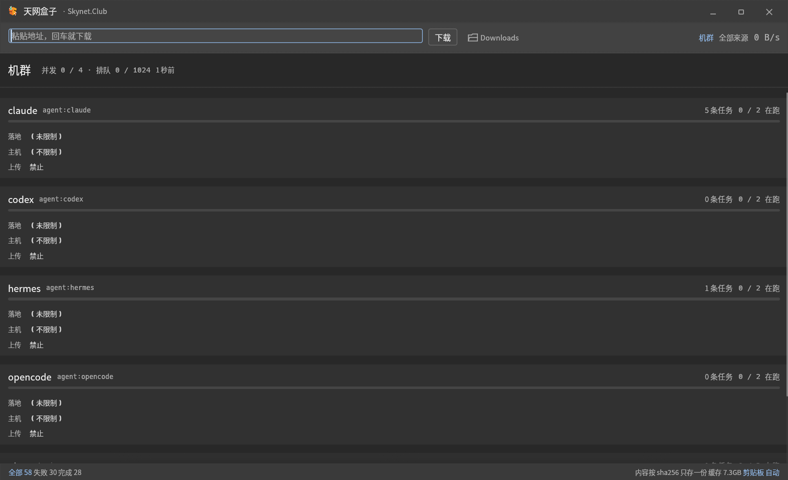

<div align="center">


# Skynet Dataplane

### The local dataplane every agent on your machine can share.

**Verified downloads and uploads · resumable transfers · content-addressed cache · fair scheduling · per-agent policy**

`CLI` · `MCP` · `HTTP API` · `Desktop GUI` · `Linux` · `macOS`

</div>

---

## Your agents do not need another download button

They need a place to answer the questions that come *after* a transfer starts:

- Is this file actually the one we asked for?
- Do five agents need five copies of the same 20 GB model?
- Which process started this download, and where did it land?
- What happens when the agent exits, the network drops, or the daemon is killed?
- Can a file be written outside its allowed directory, or uploaded from `~/.ssh`?
- When six jobs compete for the same machine, who runs first?

`curl` is excellent for one person fetching one file.  
Skynet Dataplane is for **one machine, many agents, data that must remain trustworthy**.

It runs as a local daemon and gives every agent the same ledger, cache, scheduler, resumable
partials, policy boundary, and observable event stream.



## What it does

| Problem | Skynet Dataplane |
|---|---|
| An agent cannot prove the bytes are correct | SHA-256 is a hard gate; mismatch fails the job and discards the file |
| Ten agents download the same model | Content-addressed cache keeps one blob per machine; repeat fetch can use zero network |
| A client dies halfway through | Segment bitmap and tus state survive `kill -9`; the daemon keeps ownership of the job |
| Agents overwrite each other's partials | Single-writer daemon, global scheduler, cross-process segment locks |
| Files land anywhere the agent wants | Destination roots, host allowlists, upload roots, cloud-metadata denial |
| Failures are opaque strings | Machine-readable `error_code`, `retryable`, `retry_after_ms`, and `next_action` |
| One agent monopolizes the machine | Per-agent concurrency limits, daily byte quotas, priority queue, fair scheduling |
| Consumers only know `curl` | `skyget resolve`, a curl-compatible shim, HTTP API, and 11 MCP tools |

## One daemon. Three useful surfaces.

### 1. CLI for humans and coding agents

```bash
skyget get https://example.com/model.safetensors \
  -o ~/models \
  --sha256 <64-char-sha256> \
  --as codex \
  --detach

skyget watch <job-id>
skyget daemon status
```

### 2. MCP for Claude Code, Codex, OpenCode, Hermes, pi, and other hosts

```json
{
  "mcpServers": {
    "skynet-dataplane": {
      "command": "skynet-mcp"
    }
  }
}
```

The MCP server exposes preflight, download, upload, watch, status, pause/resume/cancel,
cache pinning, and fleet views. A short portable `skyget-transfer` skill is included for
agents that work better with explicit operating instructions.

### 3. HTTP API for everything else

```http
POST /check
POST /jobs
GET  /jobs/<id>/events
GET  /cas/<sha256>
GET  /health
```

The local API is versioned, documented, and backed by conformance tests. It binds to loopback;
Unix sockets can provide kernel-verified local identity without distributing a token.

## Why this is not “just another download manager”

Three promises define the project:

1. **Verification is a first-class result.**  
   Without a digest, the product never says “verified.” A supplied SHA-256 is enforced as a
   hard gate, not a progress decoration.

2. **Content is stored once.**  
   Blobs are content-addressed. Multiple landing directories can link the same verified blob,
   and a repeated request can become a local cache hit.

3. **Resume is owned by the daemon, not the UI or the agent process.**  
   Closing the window, killing the CLI, or restarting the daemon does not silently restart a
   multi-gigabyte transfer from zero.

The same foundation powers multi-source fallback: a mirror that returns the wrong bytes is
rejected, while a healthy mirror can still complete the transfer.

## Install

### Linux package

Download `skynet-dataplane_0.24.15_amd64.deb` from the release assets:

```bash
sudo dpkg -i skynet-dataplane_0.24.15_amd64.deb
skyget daemon ensure
skyget doctor
```

### Build from source

```bash
git clone https://github.com/Skynet-Club/skyget.git
cd skyget
cargo build --release --features full
scripts/install-user.sh
skyget daemon ensure
skyget doctor
```

`skyget doctor` reports versions, directory permissions, daemon reachability, socket state,
identity mode, upload policy, and destination policy as structured checks.

## Designed to be trusted, not just fast

- **Redirects are policy-checked hop by hop.** A redirect to cloud metadata is denied before
  the connection is made.
- **Private networks and cloud metadata are separate switches.** Allowing a company mirror
  does not accidentally allow credential endpoints.
- **Credentials are references, not database values.** `env:NAME` and restricted `file:` paths
  keep secrets out of the ledger and event stream.
- **Uploads cannot read arbitrary local files.** Upload roots are opt-in; the default is deny.
- **Server-friendly behavior is built in.** Bounded concurrency, `Retry-After`, honest user
  agents, and no browser-cookie scraping.
- **Known limits are documented.** The project says what it does not support instead of
  disguising unsupported sources as “coming soon.”

Read the full [security model](https://github.com/Skynet-Club/skyget/blob/main/docs/security.md)
and [known boundaries](https://github.com/Skynet-Club/skyget/blob/main/docs/release-notes-0.24.md).

## Evidence over slogans

Version 0.24.15 was shipped only after:

- 183 unit/binary tests and 1 doc-test passed;
- the 12-item offline kernel self-test passed;
- 27 `*-e2e.sh` scenarios plus the legacy CLI suite passed;
- crash recovery was exercised with repeated `kill -9`;
- hostile servers lied about ranges, lengths, content, and throttling;
- real downloads, uploads, daemon restarts, Unix socket identity, signing, quotas, and MCP
  were exercised against real local services;
- macOS-only code paths passed cross-checks in addition to the macOS CI job.

The contract-to-test map lives in
[conformance.md](https://github.com/Skynet-Club/skyget/blob/main/docs/conformance.md).

## Honest boundaries

- Priority changes queue order; it does not preempt a running job.
- There is no per-agent bandwidth cap yet; daily byte quotas and concurrency limits exist.
- Uploads support PUT and tus 1.0, not S3 multipart yet.
- HLS/DASH child requests are handled by ffmpeg and need explicit opt-in under strict egress.
- Cross-machine shared cache is not a goal; use BT or cache export/import.
- Web-drive scraping, DRM bypass, `thunder://`, `ed2k://`, and NZB are deliberately unsupported.

The useful question is not “can it download more protocols?”  
It is: **can another agent prove what it got, avoid duplicating it, and recover when the machine
or client fails?**

## Looking for early users and collaborators

The most valuable feedback right now is concrete:

- What does your agent currently do when it needs a 10–100 GB model or dataset?
- Do multiple Claude Code, Codex, or OpenCode sessions on one machine duplicate downloads?
- Which private source blocks you today: Hugging Face, S3, an internal artifact store, HLS?
- Which security boundary is mandatory before you would run a shared local daemon?

Good next contributions:

- Metalink 1.0 input for the existing multi-source pool
- S3 multipart upload with remote checksum validation
- connection-cap stress tests and DNS-rebinding hardening
- macOS packaging and desktop integration
- independent client implementations against the HTTP/MCP contract

Open an issue with a reproducible workflow. “This failed on my machine” is welcome;
“this failed on my machine, here is the exact URL shape and event trace” is gold.

## 中文一句话

**天网盒子不是更快的下载器，而是让一台机器上的多个 AI agent 共用一套可信、可恢复、
可限权的数据面：下完能校验，重复内容只存一份，客户端死了任务还在，谁用了什么都有据可查。**

---

**Artifact:** `skynet-dataplane_0.24.15_amd64.deb`  
**SHA-256:** `f02ff96cfe4e51511e54652db5a2b296049784ef83725f6e722cdb9f59f62c58`  
**License:** MIT
